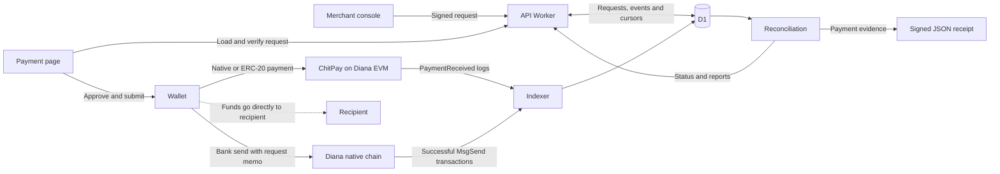

# Architecture

Chit turns a signed payment request and its matching QoreChain transfers into a record a merchant can reconcile and a payer can verify.

## Request engine

The merchant enters the recipient, asset, amount, expiry, partial-payment preference and customer-facing details. [The core request module](../packages/core/src/request.ts) creates a reference with a random Crockford Base32 body and a check character, hashes NFC-normalized details, and ABI-encodes the request with the `CHIT_REQUEST_V1` type tag. The Keccak-256 hash of those bytes is the request ID. The signed fields include the merchant, recipient, reference, chain ID and payment contract. The signing message uses QoreChain's Diana message prefix.

The merchant signs in the browser with a Chit signing key. The API verifies the hybrid signature against the merchant's registered, possession-proven ML-DSA-87 key and checks the details hash. It stores the request under its ID and enforces reference uniqueness per merchant. The payment page independently repeats the signature and request checks before offering payment. [Signing key](../app/src/signer.ts) · [API](../service/src/api.ts) · [Payment page](../app/src/pages/Pay.tsx)

## Settlement

- **ChitPay.** The Solidity contract checks the chain, contract and expiry. On the first payment it verifies the merchant's ML-DSA-87 signature through Diana's PQC precompiles and binds the merchant and reference to the request ID. Later instalments can use that recorded authentication. The contract tracks the balance due on its own route and sends native QOR or approved ERC-20 tokens directly to the recipient. Each successful payment emits `PaymentReceived`. [ChitPay.sol](../contracts/src/ChitPay.sol)
- **Native memo.** QoreX submits a hybrid-signed bank transfer to the signed recipient, converted to a `qor1…` address. The memo `chit:v1:<requestId>` ties the transfer to the request. The native chain uses six decimal places, so the app converts between `uqor` and the 18-decimal representation used for QOR in Chit. [Wallet integration](../app/src/wallet.ts) · [Memo and reconciliation](../packages/core/src/reconcile.ts)

## Indexer and reconciliation

Request detail, reference, receipt, and merchant report reads advance the EVM log cursor and scan native transactions for the relevant recipients. Each read scans up to `CHIT_BLOCKS_PER_TICK` new blocks per cursor, with EVM queries capped at 2,000 blocks and a 20-block native overlap for indexing delays. Successive reads catch up after quiet periods. Registering a request backfills matching EVM logs and resets its recipient's native cursor. A browser can submit a transaction hash for immediate lookup. The service fetches the evidence from Diana and stores each event once using its source, transaction hash and log or message index. [Indexer](../service/src/indexer.ts) · [Chain source](../service/src/chain.ts)

The reconciliation function orders unique events and checks request ID, recipient, asset, block time, confirmations and the partial-payment rule. An eligible event waits until it reaches the configured confirmation count. A second valid transfer after settlement is classified as a duplicate payment and included in the overpayment total. Reading an already stored event again leaves the total unchanged. Status is unpaid, partly paid, paid, overpaid or expired. Detail views and exports recalculate against the current head when available. Merchant list and summary reads refresh the stored totals before filtering or aggregating them. If a chain scan fails, reads can still reconcile stored evidence against the latest available head. [Reconciliation engine](../packages/core/src/reconcile.ts)

## Frontend and receipts

The merchant console creates requests, shows QR codes and shareable links, lists payment history, and exports CSV or JSON. The customer page shows the signed request and polls for confirmations after wallet submission. [App routes](../app/src/App.tsx)

The receipt contains the signed request, eligible payment evidence and derived totals. The service signs its canonical digest with ML-DSA-87. The browser checks the service attestation against the key advertised by the API and independently queries the chain for each listed transfer before recomputing the receipt. [Receipt format](../packages/core/src/receipt.ts) · [Chain verification](../app/src/receipt-chain.ts)
